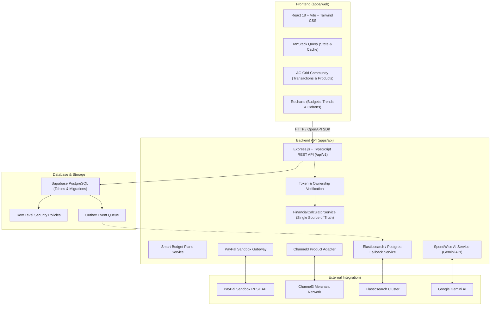

# SpendWise AI — Architecture & Technical Specifications

SpendWise AI is an independent, full-stack spending intelligence application prototype connected to PayPal Sandbox. It helps users manage monthly budgets, make informed purchasing choices with total delivered cost transparency, and benchmark spending habits through verified analytics.

---

## 1. System Architecture

---

## 2. Monorepo Structure

| Package / App | Purpose | Technology |
|---|---|---|
| `apps/web` | Modern single-page financial assistant | React 18, Vite, Tailwind CSS, AG Grid Community, Recharts, TanStack Query |
| `apps/api` | RESTful backend microservice | Node.js, Express, TypeScript, Zod, OpenAPI / Swagger |
| `packages/contracts` | Shared schemas, types, and APIMatic SDK | TypeScript, Zod, OpenAPI 3.1 |
| `supabase/` | Database migrations, RLS policies, seed fixtures | PostgreSQL SQL |
| `postman/` | Executable API collection and environment | Postman Collection v2.1 |
| `docs/` | Architectural and calculation notes | GitHub Markdown, KaTeX, Mermaid |

---

## 3. Product Boundaries & Feature Guardrails

1. **Exact Three Core Features**:
   - **Feature 1: Smart Budget Plans**: Monthly envelope planning, essential constraint markers, deterministic baselines, and structured AI optimization with feasibility checks.
   - **Feature 2: Smarter Product Search**: Channel3 adapter separating identical product merchant comparisons from vetted alternatives with delivered cost transparency and budget impact previews.
   - **Feature 3: Spending Intelligence**:
     - *Peer Spending Context*: Anonymized cohort benchmarking with a strict minimum 30-participant display threshold.
     - *My Spending Progress*: Aligned historical period comparisons (Month vs Prior-Year Month, YTD vs Prior YTD), savings rate changes, and data coverage disclosures.

2. **Excluded Features**:
   - Big Transaction Warning and Future Collision Detector are deliberately omitted from this version.
   - Future cash-flow forecasting is excluded; metrics reflect only recorded ledger transactions.

3. **Prototype Positioning**:
   - SpendWise AI is an independent hackathon prototype connected to the PayPal Sandbox. It is not hosted inside PayPal's actual customer portal.

---

## 4. Security & Data Isolation Architecture

- **Row Level Security (RLS)**: PostgreSQL enforces strict ownership check (`auth.uid() = user_id`) on all private tables (`profiles`, `transactions`, `budgets`, `paypal_orders`).
- **Server-Derived Identity**: The backend derives user identity exclusively from verified authorization tokens, never from client-submitted owner IDs.
- **Formula Injection Defense**: CSV import previews sanitize spreadsheet injection triggers (`=`, `+`, `-`, `@`, `\t`, `\r`) by prepending a single quote (`'`).
- **Idempotent Webhooks & Payments**: All PayPal capture requests and webhook events are indexed by unique transmission IDs to prevent double capture.
